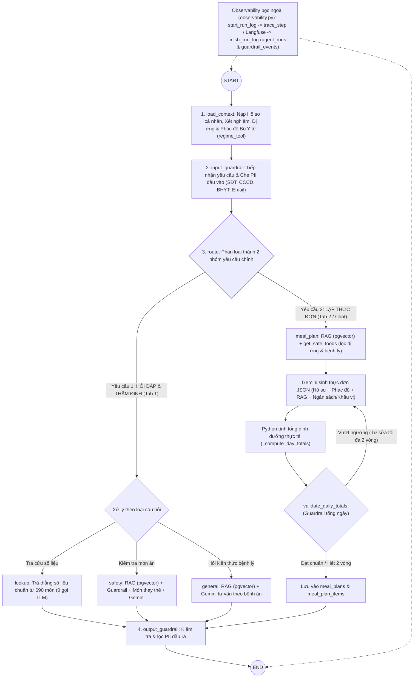

# Kiến trúc kỹ thuật & Workflow Agent – NutriGuard AI

Tài liệu mô tả kiến trúc hệ thống **NutriGuard AI** (Trợ lý Dinh dưỡng Lâm sàng cho bệnh nhân Đái tháo đường, Bệnh thận mạn & Đa bệnh lý) theo đúng 6 trụ cột: **Model**, **Workflow Agent**, **RAG & SQL Tooling**, **Guardrails**, **Observability** và **Evals**.

---

## 1. Luồng tổng thể theo trình tự lâm sàng (Hồ sơ trước $\to$ Yêu cầu sau)

1. **Bước 1 — Thiết lập Hồ sơ & Khung mục tiêu y khoa:**
   - Bệnh nhân nhập thông tin cơ bản (Tuổi, Giới, Chiều cao, Cân nặng, Bệnh lý, Dị ứng) hoặc tải ảnh/PDF phiếu xét nghiệm qua **Vision Extractor** (`src/vision/lab_extractor.py`).
   - Dữ liệu lưu vào PostgreSQL (`patients`, `checkups`, `lab_results`) và được `src/tools/regime_tool.py` đối chiếu bảng luật Bộ Y tế (QĐ 2879/QĐ-BYT) để tính ra **Khung dinh dưỡng mục tiêu** (`nutrition_targets`: mã phác đồ `DD01-X..DD08-X`, `TN01-X..TN14-X`, calo, đạm, natri, kali, phospho, GI).
2. **Bước 2 — Tiếp nhận Yêu cầu người dùng:**
   - Người dùng đặt câu hỏi / thẩm định món ở **Tab 1** hoặc yêu cầu lập thực đơn kèm ngân sách/khẩu vị ở **Tab 2** (`src/app.py`).
3. **Bước 3 — LangGraph Workflow Agent điều phối:**
   - Mọi yêu cầu đi qua cùng một đồ thị thống nhất tại `src/agent/graph.py`:
     `START` $\to$ `load_context` $\to$ `input_guardrail` $\to$ `route` $\to$ (`lookup` | `safety` | `meal_plan` | `general`) $\to$ `output_guardrail` $\to$ `END`.
4. **Bước 4 — Observability & Evals:**
   - **Observability** (`src/observability.py`): Bọc ngoài toàn bộ lượt chạy để ghi `trace_id`, `latency_ms`, `model_name` thực tế vào `agent_runs`, ghi vi phạm vào `guardrail_events`, và đẩy trace lên **Langfuse** (khi có API key).
   - **Evals** (`evals/test_safety.py`): Chạy kiểm thử định kỳ với bộ ca bệnh chuẩn trong `eval_cases` và lưu kết quả vào `eval_runs` / `eval_results`.

---

## 2. Sơ đồ LangGraph Workflow Agent (`src/agent/graph.py`)

---

## 3. Thành phần kỹ thuật chính

| Trụ cột | Công nghệ & File triển khai | Vai trò |
| :--- | :--- | :--- |
| **Model** | Google Gemini (`src/llm.py`) | Đa model fallback (`gemini-3.5-flash-lite`, `gemini-3-flash-preview`...), Structured Output JSON, Vision OCR phiếu xét nghiệm, `gemini-embedding-001` (768 chiều). |
| **Workflow Agent** | LangGraph (`src/agent/`) | `state.py`, `router.py`, `planner.py`, `graph.py` — điều phối 8 nodes kèm vòng lặp tự sửa thực đơn 2 vòng. |
| **RAG & SQL Tooling** | PostgreSQL 18 + `pgvector` (`src/rag/ingest.py`, `src/tools/`) | RAG nạp PDF/Markdown bằng `pymupdf` (chunking theo đề mục + overlap 120 ký tự); SQL Tool truy vấn 690 món ăn & 24 phác đồ Bộ Y tế. |
| **Guardrails** | `src/guardrails/` | `pii_masker.py` (che PII đầu vào/ra) + `clinical_validator.py` (chặn dị ứng & ngưỡng Kali/Natri/Phospho/GI/Đạm). |
| **Observability** | `src/observability.py` + Langfuse v5 | Ghi `agent_runs`, `guardrail_events` trong PostgreSQL và đẩy trace/span lên Langfuse. |
| **Evals** | `evals/test_safety.py` | Kiểm thử tự động độ khớp phác đồ và khả năng chặn món nguy hiểm. |
